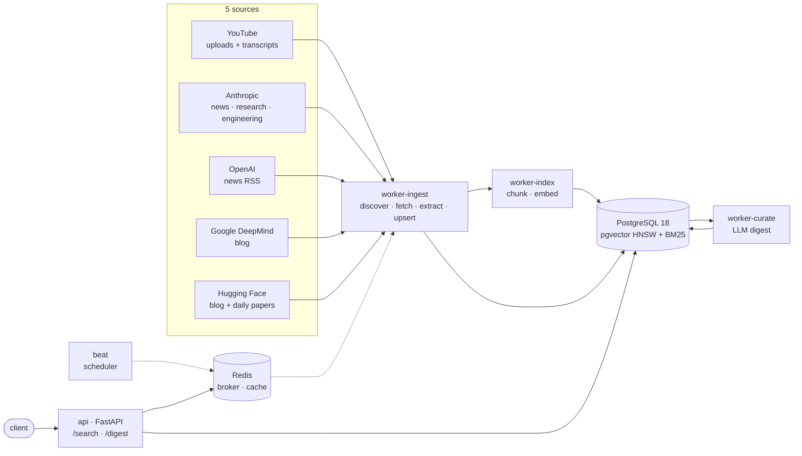
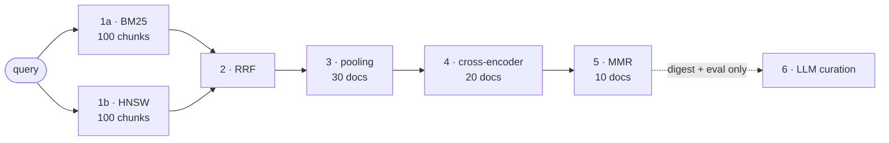

# Lodestar: multi-stage retrieval engine for AI news

Lodestar ingests AI news from five sources (YouTube transcripts, Anthropic, OpenAI, Google DeepMind and Hugging Face) into a PostgreSQL corpus. It ranks that corpus with a six-stage retrieval pipeline: BM25 + vector search, reciprocal rank fusion, pooling, a cross-encoder, MMR and LLM curation. A daily job turns the last 24 hours of news into a curated digest.

> **Status: scrapers, storage and the six retrieval stages built.** The five scrapers live in [`src/ai_news/scrapers/`](src/ai_news/scrapers/), [`src/ai_news/pipelines/ingest.py`](src/ai_news/pipelines/ingest.py) stores their output in PostgreSQL, and [`src/ai_news/rag/`](src/ai_news/rag/) chunks, embeds, indexes and ranks it. The retrieval stages run with their starting settings and haven't been evaluated yet: there is no evaluation set, so no stage has a measured effect. The API, workers, containers and CI are still the plan, and the [roadmap](#roadmap) tracks progress. The source details below (feeds, counts, page metadata) were checked against the live sites on 2026-10-07.

## What it will do

- **Ingest** everything published in the last 24 hours: long-form YouTube uploads from 31 AI channels with their transcripts, Anthropic news/research/engineering posts, OpenAI news, Google DeepMind and Hugging Face blog posts, and Hugging Face Daily Papers.
- **Index** chunks in Postgres under both a BM25 index and a pgvector HNSW index.
- **Search** through `GET /search`, which runs stages 1–5, with a p95 latency target under 400 ms.
- **Digest**: once a day, run each interest profile through all six stages. An LLM on Groq's free tier does the final curation from about 7K tokens of candidates instead of about 180K tokens of raw articles.
- **Measure** every stage against a dense-only baseline on a 40-query, 600-judgment evaluation set. CI blocks changes that drop nDCG@10 by more than 2%.

## Running it

One-time setup: copy `.env.example` to `.env`, then fill in `YOUTUBE_API_KEY` and a `POSTGRES_PASSWORD`. Then:

```bash
uv sync
docker compose up -d --wait
uv run alembic upgrade head
uv run python src/ai_news/pipelines/ingest.py
uv run python src/ai_news/rag/chunker.py
uv run python src/ai_news/rag/embeddings.py
uv run python src/ai_news/rag/pipeline.py
```

| Step | What it does |
|---|---|
| `docker compose up -d --wait` | Starts PostgreSQL 18 in Docker and waits until it's healthy. It listens on `127.0.0.1:5433`, and data survives restarts in the `postgres-data` volume |
| `uv run alembic upgrade head` | Creates or updates the tables. Run it again whenever a new migration is added |
| `uv run python src/ai_news/pipelines/ingest.py` | Scrapes all five sources for the last 24 hours and saves everything to PostgreSQL. Running it again never creates duplicates: unchanged documents are skipped and changed ones are updated |
| `uv run python src/ai_news/rag/chunker.py` | Splits the stored documents into chunks and writes them to `data/chunks.json` |
| `uv run python src/ai_news/rag/embeddings.py` | Embeds the chunks in `data/chunks.json` and stores them in the `chunk_embeddings` table. Unchanged chunks are skipped on re-runs |
| `uv run python src/ai_news/rag/pipeline.py` | Asks for your interests and runs the [retrieval pipeline](#retrieval-pipeline). With `GROQ_API_KEY` and `GROQ_MODEL` in `.env`, an LLM on Groq turns the interests into search queries and curates the results into a digest. Without them it searches with your text as typed and prints the top posts from stages 1–5 |

If one source fails, the others are still saved, and every run is logged in the `ingest_runs` table. `docker compose down` stops the database and keeps the data; `docker compose down -v` deletes it.

### Tests

```bash
uv run pytest                          # everything; integration tests need `docker compose up -d`
uv run pytest -m "not integration"     # unit tests only: no database, no network
uv run pytest --cov                    # with coverage
uv run ruff check src tests migrations && uv run ruff format --check src tests migrations
```

Integration tests create a separate `lodestar_test` database on the same server, run the migrations into it, and drop it at the end. Your `lodestar` data is never touched. If PostgreSQL isn't running, they're skipped. Scraper tests use saved pages in `tests/fixtures/`, so no test hits a live site, Groq or Hugging Face.

Each scraper file also runs on its own and only prints what its source published in the last 24 hours, without touching the database. In VS Code, select the `.venv` interpreter and use **Run Python File**.

| File | Source |
|---|---|
| `youtube.py` | YouTube uploads and transcripts. Needs `YOUTUBE_API_KEY` in `.env` |
| `anthropic_news.py` | Anthropic news, research and engineering posts |
| `openai_news.py` | OpenAI news |
| `deepmind_blog.py` | Google DeepMind blog |
| `huggingface.py` | Hugging Face blog and Daily Papers |

## Architecture



## Sources

| Source | What we ingest | Discovery | Full text | "Published" signal | Volume and notes |
|---|---|---|---|---|---|
| **YouTube** | Long-form uploads from 31 channels, plus transcripts | YouTube Data API v3: each channel's uploads playlist (needs `YOUTUBE_API_KEY`) | `youtube-transcript-api` 1.2.x | `videoPublishedAt` | At least 9 long-form videos a day. About a third of all uploads are Shorts, which get dropped |
| **Anthropic** | `/news`, `/research`, `/engineering` | `sitemap.xml` (456 article URLs) plus the three listing pages | `<article>` element | `article:published_time` meta tag | No official RSS feed, so discovery also has to come from the site itself |
| **OpenAI** | News | Official RSS (1,251 items, going back to 2015) | None: title plus a ~150-character summary | RSS `pubDate` | Article pages return 403 to non-browser clients, and we don't work around that |
| **Google DeepMind** | Blog | RSS (latest 100) for daily runs; `sitemap.xml` (~350 blog URLs) for backfill | `<article>` element | `published_time` meta tag, JSON-LD `datePublished` | The feed has titles and links only, no summaries |
| **Hugging Face** | Blog + Daily Papers | Blog RSS (875 items, going back to 2020); `GET /api/daily_papers?date=YYYY-MM-DD` | Blog: the article page. Papers: the abstract from the API | Blog: JSON-LD `datePublished`. Papers: `submittedOnDailyAt` | About 30–50 papers a day, with upvotes, authors, GitHub repo and arXiv ID |

The `robots.txt` on all four websites allows crawling. Three sources are left out of v1 to keep the scope at five: Hacker News (Algolia API), Google's AI blog RSS, and raw arXiv listings. cs.AI alone had 857 entries on the day we checked, which is too noisy without Hugging Face's curation.

<details>
<summary><b>YouTube channels</b>: 31 channels, IDs verified 2026-10-07 (kept in <code>src/ai_news/scrapers/youtube_channels.py</code>)</summary>

**AI-focused channels.** Every long-form upload is kept.

| Channel | Handle | Channel ID |
|---|---|---|
| Two Minute Papers | `@TwoMinutePapers` | `UCbfYPyITQ-7l4upoX8nvctg` |
| AI Explained | `@aiexplained-official` | `UCNJ1Ymd5yFuUPtn21xtRbbw` |
| Andrej Karpathy | `@AndrejKarpathy` | `UCXUPKJO5MZQN11PqgIvyuvQ` |
| Yannic Kilcher | `@YannicKilcher` | `UCZHmQk67mSJgfCCTn7xBfew` |
| Machine Learning Street Talk | `@MachineLearningStreetTalk` | `UCMLtBahI5DMrt0NPvDSoIRQ` |
| Anthropic | `@anthropic-ai` | `UCrDwWp7EBBv4NwvScIpBDOA` |
| OpenAI | `@OpenAI` | `UCXZCJLdBC09xxGZ6gcdrc6A` |
| Google DeepMind | `@googledeepmind` | `UCP7jMXSY2xbc3KCAE0MHQ-A` |
| Hugging Face | `@HuggingFace` | `UCHlNU7kIZhRgSbhHvFoy72w` |
| Sam Witteveen | `@samwitteveenai` | `UC55ODQSvARtgSyc8ThfiepQ` |
| bycloud | `@bycloudAI` | `UCgfe2ooZD3VJPB6aJAnuQng` |
| Matthew Berman | `@matthew_berman` | `UCawZsQWqfGSbCI5yjkdVkTA` |
| Latent Space | `@LatentSpacePod` | `UCxBcwypKK-W3GHd_RZ9FZrQ` |
| AI Coffee Break with Letitia | `@AICoffeeBreak` | `UCobqgqE4i5Kf7wrxRxhToQA` |
| DeepLearningAI | `@Deeplearningai` | `UCcIXc5mJsHVYTZR1maL5l9w` |
| No Priors | `@NoPriorsPodcast` | `UCSI7h9hydQ40K5MJHnCrQvw` |
| Cognitive Revolution | `@CognitiveRevolutionPodcast` | `UCjNRVMBVI30Sak_p6HRWhIA` |
| The AI Daily Brief | `@AIDailyBrief` | `UCKelCK4ZaO6HeEI1KQjqzWA` |
| Wes Roth | `@WesRoth` | `UCqcbQf6yw5KzRoDDcZ_wBSw` |
| Matt Wolfe | `@mreflow` | `UChpleBmo18P08aKCIgti38g` |
| TheAIGRID | `@TheAIGRID` | `UCbY9xX3_jW5c2fjlZVBI4cg` |
| Nate B Jones (AI News & Strategy Daily) | `@NateBJones` | `UC0C-17n9iuUQPylguM1d-lQ` |
| Prompt Engineering | `@engineerprompt` | `UCDq7SjbgRKty5TgGafW8Clg` |
| Umar Jamil | `@umarjamilai` | `UCtAcpQcYerN8xxZJYTfWBMw` |
| Cole Medin | `@ColeMedin` | `UCMwVTLZIRRUyyVrkjDpn4pA` |

**Mixed-topic channels.** Uploads must pass the AI-relevance filter.

| Channel | Handle | Channel ID |
|---|---|---|
| Dwarkesh Patel | `@DwarkeshPatel` | `UCXl4i9dYBrFOabk0xGmbkRA` |
| Lex Fridman | `@lexfridman` | `UCSHZKyawb77ixDdsGog4iWA` |
| Y Combinator | `@ycombinator` | `UCcefcZRL2oaA_uBNeo5UOWg` |
| Fireship | `@Fireship` | `UCsBjURrPoezykLs9EqgamOA` |
| IBM Technology | `@IBMTechnology` | `UCKWaEZ-_VweaEx1j62do_vQ` |
| 3Blue1Brown | `@3blue1brown` | `UCYO_jab_esuFRV4b17AJtAw` |

Andrej Karpathy and Yannic Kilcher post rarely. They're cheap to poll and valuable when they do post.

</details>

## Ingestion

### Shared contract

Every scraper module exposes the same function and yields one normalized record type (`models.py`):

```python
def scrape(hours: float = 24) -> Iterator[Document]: ...

class Document(BaseModel):
    source: SourceName                  # youtube | anthropic | openai | deepmind | huggingface
    source_id: str                      # video ID, URL path or arXiv ID; unique per source
    url: str
    title: str
    published_at: AwareDatetime         # timezone-aware
    content: str                        # transcript, article Markdown, summary or abstract
    content_kind: ContentKind           # transcript | article | summary | abstract
    authors: list[str]
    segments: list[TranscriptSegment]   # transcripts only: start, duration, text
    metadata: dict[str, Any]            # channel, duration, section, upvotes, ...
    fetched_at: AwareDatetime
```

Each run goes **discover → filter by time window → fetch → extract → normalize**. The scrapers don't know about the database: `pipelines/ingest.py` takes their output and stores it.

- **Time window.** `scrape(hours=24)` returns items published in the last 24 hours. Hugging Face dates papers by day only, so a 24-hour run includes every day the window touches (today's and yesterday's batches). The scheduler (Phase 6) will add 12 hours of overlap, because some sources publish only a date (a few Anthropic posts are stamped `T00:00:00Z`) and sitemaps and feeds lag behind. Records will be upserted on `(source, source_id)`, so the overlap never creates duplicates.
- **Politeness.** Every page and API request goes through one `Fetcher` (`fetcher.py`), which:
  - sends an honest User-Agent and checks `robots.txt` first;
  - makes at most 1 request per second per host;
  - retries 429 and 5xx responses with backoff, honouring `Retry-After`.
- **Extraction.** Publish dates come from standard metadata: JSON-LD `datePublished` first, then `article:published_time`. `trafilatura` converts article bodies to Markdown. On Anthropic it reads only the article-body container, which keeps newsletter and related-post blocks out.
- **Output.** `pipelines/ingest.py` upserts every document into PostgreSQL (see [Storage](#storage-and-indexing)). A scraper run on its own just prints what it found.

### YouTube

1. **Discover** uploads for every channel in `youtube_channels.py` with the YouTube Data API v3:
   - one `channels.list` call finds each channel's uploads playlist;
   - `playlistItems.list` lists each playlist's recent uploads;
   - `videos.list` adds duration and live status.

   A run costs about 33 quota units, against a free default quota of 10,000 a day. The key is sent in a request header, so it never shows up in URLs or logs. Channel RSS feeds wouldn't need a key, but YouTube's `robots.txt` disallows `/feeds/videos.xml`.
2. **Filter** to the time window, and drop Shorts (3 minutes or less) and live or upcoming streams.
3. **Check AI relevance.** Channels marked `ai_focused` skip this step. A mixed-channel video is kept if its title or the start of its description matches the AI keyword rules (`AI`, `LLM`, `GPT`, `Claude`, `Gemini`, `agentic`, `transformer`, `machine learning`, and so on). From Phase 3, a video will also be kept if its embedding is close to a set of AI-topic examples. Every dropped video is logged with a reason.
4. **Fetch the transcript** with `YouTubeTranscriptApi().fetch(video_id, languages=["en", "en-US", "en-GB"])`, which prefers manual captions over auto-generated ones. Each snippet keeps its `start` and `duration`, so a search hit can deep-link to `https://youtu.be/<id>?t=<sec>`.

   There's no official API for other channels' captions. The library reads the caption endpoints the YouTube player uses, which YouTube's `robots.txt` disallows for crawlers. So this step stays small (about 10 videos a day, 2 seconds apart) and is for personal research use.
5. **Handle failures:**

   | Failure | Handling |
   |---|---|
   | No transcript (`NoTranscriptFound`, `TranscriptsDisabled`, or captions not generated yet) | Keep the video as a `summary` document built from its description. From Phase 6, missing transcripts get retried every 2 hours for 24 hours |
   | `RequestBlocked` or `IpBlocked` | Skip transcripts for the rest of the run (see [Risks](#risks-and-mitigations)) |

Channels are plain Python in `youtube_channels.py`. Mixed-topic channels set `ai_focused=False`:

```python
Channel("Two Minute Papers", "UCbfYPyITQ-7l4upoX8nvctg"),
Channel("Lex Fridman", "UCSHZKyawb77ixDdsGog4iWA", ai_focused=False),
```

Not built: Data API `search.list` (`q=` plus `publishedAfter`) could find AI videos outside the list, but it costs 100 quota units per call and returns noisy results. The curated channel list stays the main path.

### Anthropic

Anthropic has no official RSS feed, so both discovery and parsing come from the site's HTML:

1. **Discover** candidates from two places and merge them:
   - `sitemap.xml`: URLs under `/news/`, `/research/` and `/engineering/` with `lastmod` at or after the window start. `lastmod` also changes when an old post is edited, so this picks up some extra posts but never misses a new one.
   - The `/news`, `/research` and `/engineering` listing pages. These are server-rendered with the article links in the HTML, so they catch posts the sitemap hasn't picked up yet.
2. **Fetch** each candidate and read its publish time from JSON-LD `datePublished`, falling back to `article:published_time`. Keep only posts inside the window.
3. **Extract** the article-body container to Markdown, and take the section from the URL path. Some `/research` links point to `/news/` pages, so candidates are deduplicated by URL.

### OpenAI, Google DeepMind and Hugging Face

- **OpenAI**: parse the official RSS feed and store each item's title and summary as one `summary` chunk.
- **Google DeepMind**: take recent posts and their dates from RSS, then fetch each article for its body and authors. Some posts redirect to `blog.google`, and the fetcher follows them. During backfill, older posts will come from `sitemap.xml`.
- **Hugging Face blog**: the same pattern, for official and community posts (`huggingface.co/blog/<org>/<slug>`).
- **Hugging Face Daily Papers**: make one API call per day with `limit=100`, the API's maximum (busy days reach about 80 papers). `submittedOnDailyAt` marks a paper as new, because its arXiv `publishedAt` can be days older. The content is the abstract.

## Storage and indexing

The database is PostgreSQL 18 from the `paradedb/paradedb:0.26.0-pg18` image (amd64 and arm64), run by `compose.yaml`. The image comes with **pgvector** 0.8 and ParadeDB's **pg_search** (BM25) already installed, so keyword and vector search will live in one database with no separate search service.

SQLAlchemy 2.1 models live in `src/ai_news/db/models.py`, and Alembic migrations in `migrations/` create the tables. These tables exist today:

| Table | Columns | Rules enforced by Postgres |
|---|---|---|
| `documents` | `id`, `source`, `source_id`, `url`, `title`, `content` (full text), `content_kind`, `content_hash` (SHA-256 of title + content), `word_count`, `authors` (text[]), `metadata` (jsonb), `published_at`, `first_seen_at`, `updated_at` | `(source, source_id)` is unique; `source` and `content_kind` must be known values; indexes on `published_at` and `(source, published_at)` |
| `transcripts` | `document_id`, `language_code`, `is_generated`, `segments` (jsonb list of `start`, `duration`, `text`) | One per YouTube document; deleted along with its document |
| `ingest_runs` | `id`, `source`, `status` (`running`, `succeeded`, `failed`), `window_hours`, `started_at`, `finished_at`, documents found / inserted / updated, `error` | `source` and `status` must be known values; index on `(source, started_at)` |
| `chunk_embeddings` | `id` (`<document_id>-<chunk_index>`), `document_id`, `chunk_index`, `source`, `published_at`, `content` (chunk text), `token_count`, `section`, `start_seconds` / `end_seconds`, `metadata` (jsonb), `embedding_model`, `content_hash`, `embedding vector(384)` | `(document_id, chunk_index)` is unique; deleted along with its document; index on `(source, published_at)` |

Saving is a single `INSERT … ON CONFLICT` upsert per batch of 500. A re-scraped document is updated only when its `content_hash` changes. A document that already has a transcript is never overwritten by a description-only version, for example when a later run gets blocked by YouTube.

Tables still to come:

| Table | Key columns |
|---|---|
| `digests` (Phase 6) | `profile`, `created_at`, `items` (jsonb), `model`, `input_tokens`, `output_tokens`, `baseline_tokens` |

- **Chunking** (built, in `src/ai_news/rag/`, with LangChain). `PostgresDocumentLoader` is a LangChain `BaseLoader` that reads stored documents. `DocumentChunker` is a LangChain `BaseDocumentTransformer` that splits them with `RecursiveCharacterTextSplitter`:
  - Chunks are at most 400 tokens with a 60-token overlap, counted with the embedding model's own tokenizer (`BAAI/bge-small-en-v1.5`), so no chunk can exceed its 512-token limit.
  - Articles use LangChain's Markdown separators, so they break at headings first, then paragraphs. Each chunk records its `section`; `#` lines inside code blocks don't count as headings.
  - Transcripts break at sentence punctuation, then words. Each chunk records `start_seconds`, `end_seconds` and a `timestamp_url` that opens the video at that moment.
  - Abstracts and RSS summaries usually stay as one chunk.

  Every chunk is a LangChain `Document` with a stable id (`<document_id>-<chunk_index>`) plus its parent's source, URL, title and publish date. Run `uv run python src/ai_news/rag/chunker.py` to chunk everything in the database, print a summary, and write every chunk to `data/chunks.json` (git-ignored). The file starts with the model, chunk size and overlap that produced it, so eval runs can be compared. On the first stored day, 165 documents became 330 chunks.
- **Embeddings** (built). `rag/embeddings.py` reads `data/chunks.json` and embeds each chunk with `BAAI/bge-small-en-v1.5`. It produces 384 dimensions and runs locally on CPU through `fastembed` (ONNX, no PyTorch), wrapped in LangChain's standard `Embeddings` interface. `langchain-community`, which used to provide this, is being sunset. Details:
  - Each chunk is embedded as `title — section` followed by its text, so the vector carries context its text alone lacks.
  - `rag/connector.py` stores the results in `chunk_embeddings`. A re-run skips every chunk whose fingerprint (model + embedded text) hasn't changed, re-embeds changed ones, and deletes chunks that no longer exist, for example after changing the chunk size.
  - Chunks whose document is no longer in `documents` are skipped. The model downloads once (67 MB) into `MODEL_CACHE_DIR`.
  - Bigger models are an evaluation experiment, not the default.
- **Indexes** (built, migration `0003`). Two indexes on `chunk_embeddings`:
  - HNSW on `embedding` with `vector_cosine_ops`. Each search sets `hnsw.ef_search` to at least the candidate count, because HNSW never returns more rows than `ef_search`, and turns on `strict_order` iterative scans so date and source filters still return a full list.
  - BM25 (`pg_search`) on `content` with English stemming and stopwords, so "agents" matches "agent" and "agentic", and "a" matches nothing. Queries use the `|||` operator, which matches any query term and never parses the text as query syntax, so input like `GPT-5.5 (beta)` is safe.
- **Re-embedding.** Chunks are re-embedded only when a document's `content_hash` changes.

## Retrieval pipeline

**Built** in `src/ai_news/rag/`, with the README's starting settings below. None of them has been tuned or measured yet, because that needs the [evaluation set](#evaluation).

- `retriever.py`: stage 1. `Bm25Retriever` and `PgVectorRetriever` are LangChain `BaseRetriever`s with optional `since` and `sources` filters. It also holds the Groq query expansion: `build_expander` turns the reader's interests into `RETRIEVAL_QUERY_COUNT` search queries.
- `ranking.py`: stages 2, 3 and 5, as plain functions. `reciprocal_rank_fusion` fuses chunk rankings, `pool` turns chunks into posts (`POOLING_METHOD`: `max`, `top3` or `combmnz`) and keeps each post's best chunk, and `maximal_marginal_relevance` picks the final list.
- `reranker.py`: stage 4. `CrossEncoderReranker` runs `RERANK_MODEL` through fastembed (ONNX). It scores the title, section and best passage of each post against every query and keeps the highest score, so a post that matches any one interest counts as relevant. The raw score is kept as `rerank_score`, and its sigmoid as `relevance` (0–1), which MMR weighs against cosine similarity.
- `curation.py`: stage 6. `Curator` sends the candidates to the LLM and gets back a structured `Digest` of at most 10 items, each with a headline, one line on why it matters and the ids of every candidate it merges. Ids the LLM invents are dropped, and token usage is read from the response.
- `pipeline.py`: `SearchPipeline.search(queries)` runs stages 1–5 for one or more queries, timing each stage in the log, and `main()` adds query expansion and curation.

With several queries, each one runs both retrievers, and RRF fuses all the rankings at once.



| # | Stage | What it does | Starting point (tuned in Phase 5) |
|---|---|---|---|
| 1 | Hybrid candidates | Runs BM25 and HNSW queries over chunks concurrently | 100 chunks each |
| 2 | RRF | Reciprocal rank fusion: `score = Σ 1 / (k + rank)`. It uses ranks only, so BM25 and cosine scores never need a common scale | k = 60 |
| 3 | Pooling | Combines chunk scores into document scores, comparing max, top-3 sum and CombMNZ. One long transcript can't fill the page, and each document keeps its best passage | 30 docs |
| 4 | Cross-encoder | Re-scores each (query, title + best passage) pair jointly | `ms-marco-MiniLM-L-6-v2` (ONNX), keeps 20 docs |
| 5 | MMR | Trades relevance against redundancy, such as four write-ups of one launch | λ = 0.7, keeps 10 docs |
| 6 | LLM curation | The LLM (Groq) selects, orders and merges same-story items and adds one line on why each matters, as structured JSON | 15 docs in, at most 10 out |

`/search` runs stages 1–5. Stage 6 runs only in the digest job and in offline evaluation, which keeps the LLM out of the request path.

**Latency budget for `/search`.** These are estimates, to be replaced by k6 measurements in Phase 6:

| Step | p95 budget |
|---|---|
| Query embedding (cached in Redis) | 15 ms |
| BM25 and HNSW in parallel | 40 ms |
| RRF + pooling + MMR | 15 ms |
| Cross-encoder, 30 pairs on CPU | 200 ms |
| Framework + network | 30 ms |
| **Total** | **~300 ms** (target under 400 ms) |

Models load once at startup, and CPU-bound inference runs in a thread pool so the async event loop never blocks. If the cross-encoder runs over budget, the fix is to send it fewer pairs or shorter passages.

**Digest token budget.** The naive digest pastes every document from the last 24 hours into one prompt, about 180K tokens. Lodestar sends about 15 candidates per profile, each as a title plus its best passage, about 7K tokens. Both numbers are measured:

- The naive figure is counted with the model's tokenizer on the same day's documents.
- The real figure comes from each response's `usage` field and is logged to `digests`.

Groq's free tier has no per-token bill, but it enforces per-minute and per-day token limits (see your account's limits page), so the smaller prompt is what keeps a daily run inside them.

## Evaluation

The evaluation set is built **before** stages 2–6 are tuned, so every stage has to earn its place.

- **Frozen corpus.** Snapshot v1 (about 18K chunks) is exported to Parquet (documents, chunks, embeddings) and attached to a GitHub Release. Every reported number names its snapshot, so daily ingestion never moves the metrics.
- **40 queries.** They're written before looking at any system output, and they're deliberately mixed:
  - exact names of models and papers, where BM25 is strong;
  - paraphrased concepts, where dense retrieval is strong;
  - time-scoped questions ("what did Anthropic ship this week");
  - cross-source questions ("reactions to the Gemini 4 launch").
- **600 judgments (40 × 15).** These come from TREC-style pooling: round-robin over the rankings of four systems (BM25-only, dense-only, hybrid, hybrid + rerank) until each query has 15 unique documents. Each document is graded 0–3 (not relevant / marginally / relevant / highly relevant).
- **Labelling.** An LLM on Groq pre-labels against a written rubric, in small batches to stay inside the free-tier rate limits. Every label is then reviewed by hand, and LLM–human agreement (Cohen's κ) is reported.
- **Metrics:**
  - nDCG@10, the primary metric;
  - Recall@50, for the candidate stages;
  - MRR@10;
  - Judged@10, the share of the top 10 that was actually judged. When it's low, the metric is guessing.

  Stage-to-stage differences get a paired randomization test (`ranx`), because 40 queries is a small sample.
- **Baseline.** Dense-only: HNSW top chunks, deduplicated to documents by first occurrence.

The ablation table gets filled in during Phase 5:

First run, 2026-11-11 (`uv run python src/ai_news/evaluation/evaluate.py`). **Grades are LLM pre-labels (`openai/gpt-oss-20b`), not yet reviewed by hand**, so treat these as provisional. Unjudged documents count as not relevant; Judged@10 was 0.80–0.87 for every system. p is a paired randomization test against dense-only (10,000 trials, 40 queries).

| Configuration | nDCG@10 | Recall@10 | MRR@10 | Judged@10 | Δ nDCG@10 | p |
|---|---|---|---|---|---|---|
| BM25 only (reference) | 0.627 | 0.664 | 0.694 | 0.835 | −0.126 | 0.043 |
| Dense only (baseline) | 0.752 | 0.792 | 0.815 | 0.820 | — | — |
| + BM25 + RRF + max pooling | 0.715 | 0.742 | 0.815 | 0.843 | −0.037 | 0.42 |
| + cross-encoder | **0.826** | 0.843 | 0.917 | 0.865 | +0.074 | 0.026 |
| + MMR (full stages 1–5) | 0.805 | 0.820 | 0.917 | 0.805 | +0.053 | 0.13 |
| + LLM curation | | | | | | |

By query type (nDCG@10, dense → + cross-encoder): exact 0.983 → 0.982, paraphrase 0.737 → 0.787, time 0.489 → 0.529, cross-source 0.676 → 0.885. Time-scoped queries are the weakest for every system, because no stage reads dates from the query. Full per-query results are in `eval/results/`.

MMR optimizes for diversity and may cost a little nDCG. If it does, that trade-off is reported alongside a redundancy measure rather than hidden.

## Services

Async **FastAPI** serves requests. **Celery** on **Redis** does background work, split into queues so slow scrapers never starve indexing.

| Endpoint | Purpose |
|---|---|
| `GET /search?q=&k=&source=&since=` | Stages 1–5 |
| `GET /digest/latest`, `GET /digest/{date}` | Precomputed curated digest |
| `GET /documents/{id}` | Metadata, snippets and a link to the original |
| `POST /admin/ingest` | Trigger an ingest run (token-protected) |
| `GET /healthz`, `GET /readyz` | Liveness; readiness (DB and Redis reachable) |
| `GET /metrics` | Prometheus: per-stage latency, ingest counts |

**Schedule (Celery beat):**

| Job | When | Notes |
|---|---|---|
| Ingest, then index new documents | Every 6 hours | The overlap window and idempotent upserts make repeat runs harmless |
| Retry pending transcripts | Every 2 hours | |
| Build the digest | Daily at 07:00 IST | One per profile in `config/profiles.yaml`, e.g. "frontier model releases", "agents and dev tooling", "safety and policy", "papers worth reading" |

**The nine Compose services:**

| Service | Image | Role | Health gate |
|---|---|---|---|
| `db` | `paradedb/paradedb:0.26.0-pg18` | Postgres + pgvector + pg_search | `pg_isready` |
| `redis` | `redis:8-alpine` | Broker, result backend, query cache | `redis-cli ping` |
| `migrate` | app | Runs `alembic upgrade head`, then exits | Must finish before app services start |
| `api` | app | FastAPI on uvicorn | `GET /readyz` |
| `worker-ingest` | app | `ingest` queue: scrapers (I/O-bound, high concurrency) | `celery inspect ping` |
| `worker-index` | app | `index` queue: chunk + embed (CPU-bound) | `celery inspect ping` |
| `worker-curate` | app | `curate` queue: LLM digests (rate-limited) | `celery inspect ping` |
| `beat` | app | Scheduler | Process check |
| `flower` | app | Celery monitoring UI | `GET /healthcheck` |

App services declare `depends_on` with `condition: service_healthy`, or `service_completed_successfully` for `migrate`. Nothing starts against a database that isn't ready.

## Containers

- **Multi-stage Dockerfile** with three stages:
  1. A `uv` builder runs `uv sync --locked --no-dev` with BuildKit cache mounts.
  2. A model stage downloads the ONNX models into their own cached layer.
  3. A `python:3.12-slim` runtime copies in only the virtualenv and the models.
- **Size.** The image uses ONNX Runtime instead of PyTorch + CUDA, has no compilers in the runtime, and has a strict `.dockerignore`. The "before" figure comes from first building a naive image (`python:3.12` + `pip install sentence-transformers`, which pulls in CUDA PyTorch) and recording its size.
- **Hardening.** A non-root user (UID 10001), a `HEALTHCHECK` in every image, and a read-only root filesystem where possible.
- **Multi-arch.** `docker buildx build --platform linux/amd64,linux/arm64`, so it can be developed on Apple Silicon and deployed on either architecture.

## CI/CD

| Workflow | Runs on | What it does |
|---|---|---|
| `ci.yml` (**built**) | PRs, pushes | `ruff` lint and format check, and `pytest` with an 87% coverage gate against a ParadeDB service container. `mypy` comes later |
| `security.yml` | PRs, pushes, weekly | `pip-audit` (dependencies), `bandit` (SAST), `gitleaks` (secrets), Trivy config scan (Dockerfile, Compose) |
| `eval-gate.yml` | PRs touching retrieval or eval | Loads the snapshot into a Postgres service container and runs stages 1–5 on the 40 queries. **Fails if nDCG@10 drops more than 2%** against `eval/baseline.json`, and posts the table to the job summary |
| `docker-publish.yml` | `main`, tags | Multi-arch buildx with the GitHub Actions cache, push to GHCR, Trivy image scan, SBOM (Syft, SPDX), cosign keyless signature and SBOM attestation |
| `deploy.yml` | After a successful publish | Runs `cosign verify`, deploys by image digest, and smoke-tests `/readyz` and one search. Rolls back to the previous digest automatically on failure |
| `rollback.yml` | Manual | Redeploys any earlier signed digest |

The eval gate covers stages 1–5 only. Stage 6 costs money and isn't deterministic, so it's re-evaluated by hand whenever the prompt or model changes. Scraper tests run against saved fixtures in `tests/fixtures/`, so CI never hits the live sites; `pytest -m live` runs real smoke tests on demand.

## Targets

The targets come from the project brief. The **Measured** column is filled in from real runs, and that's the number to quote.

| Metric | Target | How it's measured | Measured |
|---|---|---|---|
| Sources | 5 | YouTube, Anthropic, OpenAI, Google DeepMind, Hugging Face | — |
| Corpus (eval snapshot) | ~18K chunks | `SELECT count(*) FROM chunks` on snapshot v1 | — |
| nDCG@10, dense-only vs full pipeline | 0.48 → 0.63 | `evaluate.py`: 40 queries, 600 judgments | 0.752 → 0.805 (LLM-judged, unreviewed) |
| LLM tokens per digest run | ~180K → ~7K | tokenizer count (naive) against response `usage`, median of 14 daily runs | — |
| `/search` latency | p95 under 400 ms | k6 replaying the 40 eval queries at a fixed rate, on documented hardware | — |
| App image size | 6.2 GB → 1.3 GB | `docker image ls`, naive build against optimized build | — |
| Test coverage | 87% or more | `pytest --cov` in `ci.yml` | 91% (188 tests, 2026-11-11) |
| Regression gate | Blocks a drop in nDCG@10 of more than 2% | `eval-gate.yml` | — |

## Project layout

Built so far:

```text
ai-news/
├── src/ai_news/
│   ├── config.py               # settings from .env (pydantic-settings)
│   ├── log_config.py           # shared logging setup
│   ├── scrapers/
│   │   ├── models.py           # Document, Transcript, TranscriptSegment
│   │   ├── fetcher.py          # polite HTTP: robots.txt, per-host pacing, retries
│   │   ├── parsing.py          # dates, RSS entries, article pages to Markdown
│   │   ├── registry.py         # source name → scrape function
│   │   ├── runner.py           # shared helper behind each file's __main__ block
│   │   ├── youtube.py
│   │   ├── youtube_channels.py
│   │   ├── anthropic_news.py   # names avoid shadowing the anthropic/openai SDK packages
│   │   ├── openai_news.py
│   │   ├── deepmind_blog.py
│   │   └── huggingface.py      # blog + daily papers
│   ├── db/
│   │   ├── base.py             # declarative base + constraint naming convention
│   │   ├── models.py           # documents, transcripts, ingest_runs
│   │   ├── session.py          # engine and session factory
│   │   └── repository.py       # upserts and run bookkeeping
│   ├── pipelines/
│   │   └── ingest.py           # scrape every source → PostgreSQL
│   ├── rag/                    # LangChain retrieval pipeline
│   │   ├── loader.py           # PostgreSQL documents → LangChain Documents
│   │   ├── chunker.py          # token-aware splitting with sections and timestamps
│   │   ├── embeddings.py       # data/chunks.json → embeddings (fastembed behind LangChain Embeddings)
│   │   ├── connector.py        # stores embeddings in chunk_embeddings
│   │   ├── retriever.py        # stage 1: BM25 and HNSW retrievers, Groq query expansion
│   │   ├── ranking.py          # stages 2, 3, 5: RRF, pooling, MMR
│   │   ├── reranker.py         # stage 4: cross-encoder
│   │   ├── curation.py         # stage 6: LLM digest with structured output
│   │   └── pipeline.py         # runs the stages; interactive entry point
│   └── evaluation/             # pooling.py (snapshot + pools), labeling.py (LLM pre-labels), evaluate.py + metrics.py (nDCG@10)
├── eval/                       # queries, snapshot manifest, pools, judgments (see eval/README.md)
├── tests/
│   ├── unit/                   # no network, no database: ranking, metrics, scrapers on fixtures, chunking, labeling
│   ├── integration/            # real PostgreSQL: migrations, upserts, BM25 + HNSW retrievers, stages 1–5
│   └── fixtures/               # saved HTML, RSS and sitemap pages
├── .github/workflows/ci.yml    # lint + tests with a coverage gate
├── migrations/                 # Alembic env.py, template and versions/
├── compose.yaml                # PostgreSQL 18 (ParadeDB image)
├── .env.example
└── pyproject.toml              # dependencies + Alembic and ruff config
```

Still to come: `cli.py`, `api/`, `worker/`, `config/profiles.yaml`, `docker/Dockerfile`, `docs/benchmarks.md` and the other five workflows.

## Roadmap

### Phase 0: Foundations
- [ ] Runtime dependencies: `httpx`, `feedparser`, `trafilatura`, `lxml`, `youtube-transcript-api`, `pydantic`, `pydantic-settings`, `typer`, `tenacity`, `structlog`, `pyyaml`
- [x] Dev dependencies: `pytest`, `pytest-cov`, `ruff` (`pytest-asyncio`, `respx`, `mypy`, `pre-commit` still to add)
- [ ] `config.py` and `.env.example`, structured logging, the Typer CLI skeleton, tool config in `pyproject.toml`, and `data/` and `.env` added to `.gitignore`
- **Done when** `uv run ai-news --help` and `uv run pytest` both pass.

### Phase 1: Scrapers (in progress)
- [x] **Core**: `Document` and `TranscriptSegment` models, the polite `Fetcher` (robots.txt, per-host pacing, retries), parsing helpers, and a shared runner so every scraper file runs on its own
- [x] **YouTube**: Data API discovery, Shorts/live/AI-topic filters, and transcripts
- [x] **Anthropic**: sitemap and listing-page discovery, JSON-LD publish dates, article body to Markdown
- [x] **OpenAI** (RSS), **Google DeepMind** (RSS + article), **Hugging Face** (blog RSS + article, Daily Papers API)
- [ ] **CLI**: `ai-news scrape <source> --hours 24`
- [ ] **Tests**:
  - saved fixtures and parser tests for each source;
  - time-window edges: date-only timestamps, the overlap, timezones;
  - Shorts, and missing transcripts;
  - `pytest -m live` smoke tests.
- **Done when** `uv run ai-news scrape all --hours 24` stores all five sources and the offline test suite passes.

### Phase 2: Storage and backfill (in progress)
- [x] `compose.yaml` with PostgreSQL 18, SQLAlchemy 2.1 models, Alembic migrations
- [x] Idempotent upserts, `content_hash` change detection, `ingest_runs` bookkeeping, and `pipelines/ingest.py`
- [ ] `redis` service (needed once Celery arrives in Phase 6)
- [ ] `ai-news backfill --days N`, drawing on sitemaps, RSS history, Daily Papers by date and YouTube uploads playlists. Transcript fetching is throttled
- **Done when** re-running a scrape inserts zero rows and `ai-news stats` shows counts per source.

### Phase 3: Chunking and indexing (in progress)
- [x] LangChain loader and chunker (article, transcript and single-chunk handling, sections, timestamps)
- [x] Embeddings (`rag/embeddings.py`) and the `chunk_embeddings` table (`rag/connector.py`, migration `0002`)
- [x] HNSW and BM25 indexes (migration `0003`)
- [ ] `ai-news search "<query>" --stages bm25` and `--stages dense`
- **Done when** both single-retriever modes return sensible results for hand-picked queries.

### Phase 4: Evaluation set
- [ ] Freeze snapshot v1 and export it to Parquet
- [x] Write the 40 queries, then build the pools (`eval/`: 600 pooled documents from four systems, on a 1,333-document, 2,473-chunk snapshot; see [`eval/README.md`](eval/README.md))
- [x] Get LLM pre-labels from Groq for all 600 (`src/ai_news/evaluation/labeling.py`)
- [x] Build the evaluator (`src/ai_news/evaluation/evaluate.py`): nDCG@10, Recall@10, MRR@10, Judged@10, paired randomization test
- [ ] Review all 600 labels by hand and compute κ
- [ ] Build the `ai-news eval` harness and record the dense-only baseline in `eval/baseline.json`
- **Done when** the baseline row of the ablation table is filled in.

### Phase 5: Retrieval pipeline
- [x] All six stages implemented with their starting settings (`rag/pipeline.py`)
- [ ] Give each stage its ablation row and significance test, in order, once the evaluation set exists
- [ ] Sweep the main settings: RRF k, pool size, pooling function, rerank depth, MMR λ
- **Done when** the ablation table is complete and the chosen defaults are recorded.

### Phase 6: API, workers and digest
- [ ] FastAPI app: models loaded at startup, inference in a thread pool, a Redis cache, and the endpoints above
- [ ] Celery app with three queues, the beat schedule, `acks_late` and idempotent tasks
- [ ] Digest per profile with LLM structured output (Groq), plus token accounting (naive against pipeline)
- [ ] k6 load test, with p50/p95/p99 written to `docs/benchmarks.md`
- **Done when** `docker compose up` serves `/search` within budget and produces a daily digest.

### Phase 7: Containers
- [ ] Build the naive image and record its size as the baseline
- [ ] Multi-stage, non-root, health-checked, multi-arch images, with all nine services gated on health
- **Done when** `docker compose up --wait` goes green on amd64 and arm64, and both image sizes are in `docs/benchmarks.md`.

### Phase 8: CI/CD
- [x] `ci.yml`: lint, format check, unit + integration tests, 87% coverage gate
- [ ] The other five workflows
- [ ] Pick a deploy target, for example one small VM running Compose and pulling images from GHCR by digest
- [ ] Prove rollback works by deploying a deliberately broken image
- **Done when** every workflow is green on `main` and the broken deploy rolled itself back.

### Phase 9: Write-up
- [ ] Fill in the Measured column and the ablation table, add a short demo, and note what didn't work

## Risks and mitigations

| Risk | Mitigation |
|---|---|
| YouTube blocks transcript requests from cloud and datacenter IPs (`RequestBlocked`, `IpBlocked`) | Fetch transcripts from a home connection, 2 seconds apart, and stop at the first block |
| Transcripts come from caption endpoints that YouTube's `robots.txt` disallows, and there's no official alternative for other channels' videos | Keep volume low (about 10 videos a day), use transcripts for personal research only, and drop them if YouTube objects |
| `youtube-transcript-api` relies on undocumented YouTube internals | Pin the version, and keep it behind one small class (`TranscriptFetcher`) so a fallback can be swapped in. Alert when the success rate drops |
| Captions aren't ready right after upload | Keep the video as a summary for now; from Phase 6, retry for 24 hours |
| OpenAI article pages return 403 | Use the RSS title and summary only. Don't bypass the block |
| Site redesigns break parsers | Read standard metadata first and use selectors last. Keep fixture tests, and alert when a source returns 0 items 3 runs in a row |
| Date-only timestamps and feed lag at the edge of the 24-hour window | Use the 12-hour overlap plus idempotent upserts |
| Biased or noisy evaluation | Write queries before seeing results, pool across 4 systems, report Judged@10, review every LLM label by hand, and report κ and significance tests |
| LLM spend creeping up | Cap tokens per run, checked with a tokenizer count before sending, and fix a maximum item count in the output schema |
| Copyright and terms of use | Respect robots.txt, identify the crawler, and make at most 1 request per second per host. Store content for indexing only. The API serves snippets and links back to the source |

## Configuration

Secrets go in a `.env` file at the project root (copy `.env.example`). `.env` is git-ignored.

| Variable | Needed from | Purpose |
|---|---|---|
| `YOUTUBE_API_KEY` | Phase 1 | Required by the YouTube scraper. Create it in Google Cloud Console after enabling "YouTube Data API v3" |
| `POSTGRES_HOST`, `POSTGRES_PORT`, `POSTGRES_DB`, `POSTGRES_USER`, `POSTGRES_PASSWORD` | Phase 2 | Used by both `compose.yaml` and the app. Defaults: `localhost`, `5433` (5432 is often taken by a local Postgres), `lodestar`, `lodestar`; the password has no default |
| `REDIS_URL` | Phase 6 | Celery broker |
| `EMBEDDING_MODEL`, `CHUNK_SIZE_TOKENS`, `CHUNK_OVERLAP_TOKENS` | Phase 3 | Defaults: `BAAI/bge-small-en-v1.5`, `400`, `60`. The chunker counts tokens with this model's tokenizer. The overlap must be smaller than the chunk size, and a bad value stops the run with a clear error. For an eval run, override them without editing `.env`, for example `CHUNK_SIZE_TOKENS=200 CHUNK_OVERLAP_TOKENS=0 uv run python src/ai_news/rag/chunker.py` |
| `HF_TOKEN` | Optional | A free Hugging Face read token (huggingface.co → Settings → Access Tokens). Downloads model files with higher rate limits and removes the "unauthenticated requests" warning. Everything works without it |
| `MODEL_CACHE_DIR` | Optional | Where embedding models are stored after their first download. Default: `~/.cache/fastembed` |
| `RERANK_MODEL` | Phase 5 | Default: `Xenova/ms-marco-MiniLM-L-6-v2` |
| `GROQ_API_KEY`, `GROQ_MODEL` | Phase 5 | Required by the retriever, and later by evaluation pre-labels and digest curation. Get a free key at console.groq.com, and choose any model your account can use. Both are blank in `.env.example` |
| `RETRIEVAL_QUERY_COUNT` | Phase 5 | Default: `5`. How many search queries the LLM writes from the reader's interests |
| `RETRIEVAL_CANDIDATES`, `RRF_K`, `POOLING_METHOD`, `POOL_SIZE`, `RERANK_KEEP`, `MMR_LAMBDA` | Phase 5 | Defaults: `100`, `60`, `max`, `30`, `20`, `0.7`. Chunks each retriever fetches per query, the RRF constant, how chunk scores become post scores (`max`, `top3` or `combmnz`), posts kept after pooling, posts kept after the cross-encoder, and MMR's weight on relevance against variety |
| `RETRIEVAL_TOP_K`, `CURATION_CANDIDATES` | Phase 5 | Defaults: `10`, `15`. Posts returned by stages 1–5, and posts sent to the LLM for curation, which returns at most 10 |
